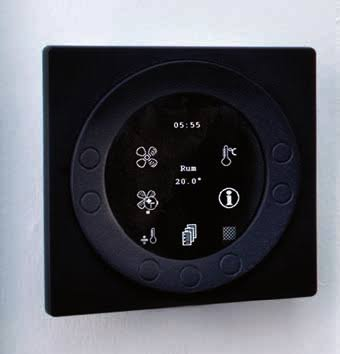
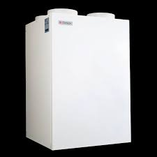
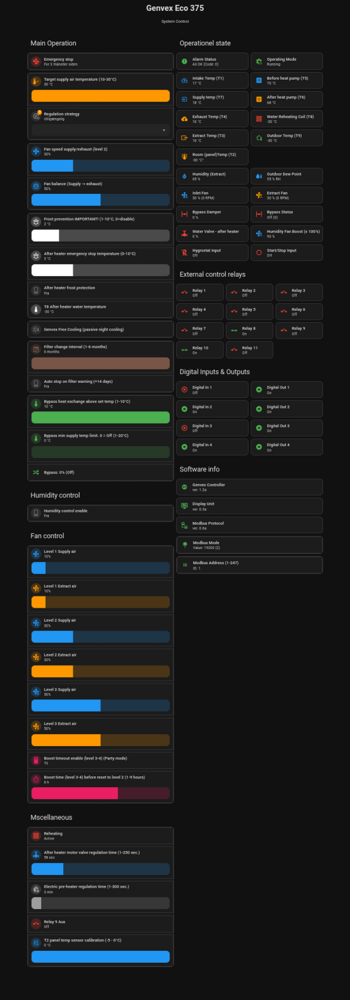

# Genvex Eco 375 Modbus Integration for Home Assistant

This repository contains a complete integration of **Genvex Eco 375** ventilation unit into Home Assistant via Modbus, including a structured package setup, control panels, and status overviews.

<p float="left">
  
  
</p>

## Files in this Repository
* **`genvex_modbus.yaml`**: The Modbus package that creates all sensors, entities, and controls for Home Assistant.
* **`genvex_panel1.yaml`**: Lovelace dashboard YAML for settings and control entities.
* **`genvex_panel2.yaml`**: Lovelace dashboard YAML for displaying states and operational metrics.

---

## 📂 Folder Structure
To keep your Home Assistant configuration clean and organized, place the files using the following structure:

config/  <br>
├── configuration.yaml  <br>
└── packages/  <br>
&nbsp;&nbsp;&nbsp;&nbsp;└── genvex_modbus.yaml

---

## 🛠️ Prerequisites

1. A stable Modbus connection to your Genvex Eco 375 (e.g., via a optima 251 controler ).
2. **Packages** enabled in your `configuration.yaml`.

---

## 📥 Installation

### 1. Enable Packages (if not already done)

Ensure your `configuration.yaml` includes the packages directory:

```yaml
homeassistant:
  packages: !include_dir_named packages

```

*(If you don't have a `packages` folder in your `/config/` directory, create it).*

### 2. Add the Modbus Package (`genvex_modbus.yaml`)

1. Place the `genvex_modbus.yaml` file inside your `/config/packages/` folder.
2. Open the file and verify your Modbus hub settings.
3. Restart Home Assistant to load all Modbus registers and entities.

### 3. Set Up the UI Panels (Frontend)

1. Create a new empty Dashboard in Home Assistant (or a new view tab in your existing dashboard).
2. Click the three dots in the top right corner $\rightarrow$ **Edit Dashboard**.
3. Click the dots again $\rightarrow$ **Raw configuration editor**.
4. Paste the code from `genvex_panel1.yaml` and `genvex_panel2.yaml` (or combine them as preferred) to set up your cards.



## Notes

* HA controle fan setting 2. Fan speed setting 1,3 and 4 remain manual settings controled by the optima panel.

---

## 🧪 Tested Hardware & Compatibility
This integration has been tested and verified on the following setup:

| Ventilation Unit | Control Panel | Connection Method | Community Contributor | Notes |
| :--- | :--- | :--- | :--- | :--- |
| **Genvex Eco 375** | Optima 251 | USB / Modbus adapter | [@paragi](https://github.com/paragi) | Direct connection to panel |

### Have you tested this with another setup?
If you use this integration with a different setup, please feel free to open a pull request or submit update this compatibility list so others can benefit from it!

🤝 Contributing & Sharing Improvements

Contributions, feedback, and further developments are very welcome! If you make improvements, find bugs, or adapt the configuration for other versions, feel free to open a pull request or share your ideas so others can benefit from them.


## 📸 Preview

## 📄 License

Distributed under the MIT License. Feel free to use and modify the code as needed.
